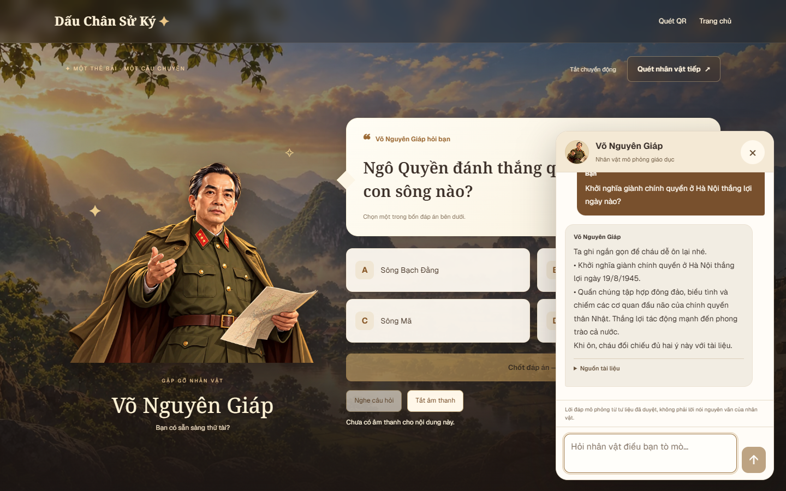
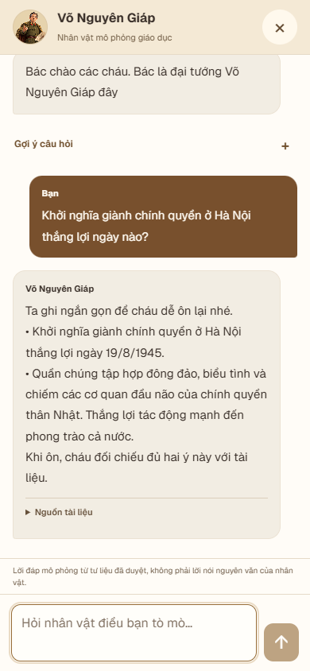
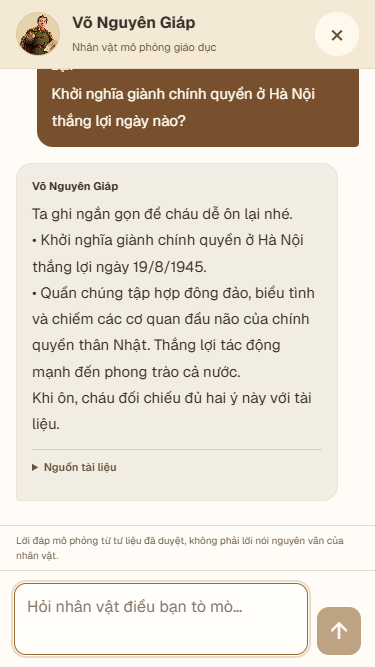

# Phase 5A — UI/UX chatbot cho demo

Ngày thực hiện: 15/10/2026. Hoàn thành trên source hiện tại sau Phase 4; chưa deploy và không bắt đầu Phase 5B.

## Phạm vi và khảo sát

Đã đọc implementation guide, báo cáo và kết quả test Phase 4, component popup, CSS, HTTP client và GamePlayer. Đã kiểm tra conventions `.agents/rules/` và tài liệu Client Components/CSS của phiên bản Next.js cài trong repository.

Luồng dữ liệu giữ nguyên:

```text
QR / trang nhân vật → GamePlayer → CharacterChat
  → session server hiện có / Server Action binding của Phase 4
  → chat-client → /api/chat hoặc /api/chat/answer
  → lời đáp published của đúng nhân vật
```

Trước thay đổi, popup luôn cuộn xuống cuối khi có tin/loading; trên mobile vẫn là cửa sổ nhỏ; gợi ý chiếm diện tích liên tục; lỗi gửi chưa có nút retry giữ nguyên yêu cầu. Phase này sửa phần trình bày và state giao diện, không sửa API hoặc xác thực session.

## Thay đổi UI/UX

### Desktop

- Giữ cửa sổ nổi góc phải, rộng 400px, cao tối đa 640px và giới hạn theo chiều cao viewport.
- Nền giấy sáng, header nhẹ, phân biệt rõ tin người chơi màu nâu và tin nhân vật màu sáng; có nhãn người gửi.
- Font nội dung 14px, line-height 1.75, khoảng cách giữa các tin và nút bấm được tăng. Có wrap cho nội dung dài.
- Khi mở, ẩn nút launcher phía dưới để dành không gian; nút đóng nằm trên header. Khi đóng, launcher xuất hiện lại.

### Mobile

- Từ 640px trở xuống, popup chiếm toàn vùng hiển thị, không còn cửa sổ nhỏ nằm trên boardgame.
- Dùng `100dvh` làm fallback, cập nhật chiều cao/vị trí/rộng từ `window.visualViewport` khi resize hoặc scroll để ô nhập nằm trong vùng nhìn thấy khi bàn phím xuất hiện.
- Hỗ trợ `safe-area-inset-*`, textarea 16px và nút đóng 44×44px.
- Header, thông báo và composer không cuộn cùng lịch sử; vùng tin nhắn là vùng cuộn chính. Textarea có thể cuộn nội dung đang nhập dài.
- Chỉ khóa cuộn trang nền trong lúc popup mobile mở; lưu và khôi phục style body cùng vị trí cuộn khi đóng hoặc unmount. Không remount GamePlayer, không thay câu quiz/đáp án đang chọn.
- Dialog có `aria-modal` trên mobile, vòng focus bằng Tab, Escape để đóng và trả focus về launcher. Không tự focus textarea khi vừa mở để tránh bật bàn phím ngay.

### Hội thoại và cuộn

- Chỉ tự theo tin mới khi đang ở cuối (cách cuối dưới 48px).
- Nếu đang đọc tin cũ, giữ vị trí khi phản hồi mới đến. Có nút “Tin nhắn mới” hoặc “Xuống cuối”.
- Khi chủ động gửi, đưa người chơi về lượt trao đổi mới. Khi đóng/mở lại, giữ lịch sử và vị trí đọc trong phiên UI.
- Giữ focus ô nhập khi gửi bằng `readOnly` trong lúc chờ, thay vì disable khiến bàn phím có thể đóng. Khi offline/hết phiên/quota chưa hết thời gian chờ, ô nhập vẫn bị khóa phù hợp.
- Loading có nhãn văn bản và dấu chấm chuyển động; tôn trọng reduced motion và điều khiển tắt chuyển động hiện có.
- Enter gửi, Shift+Enter xuống dòng; kiểm tra composition state, `isComposing` và keyCode 229 để không gửi lúc xác nhận ký tự IME.

### Gợi ý, lời đáp và nguồn

- Tối đa 3 gợi ý ban đầu lấy từ endpoint Published Knowledge hiện có; không hardcode câu hỏi.
- Có nút mở/thu gọn gợi ý. Sau lần gửi đầu tiên, vùng này tự thu gọn nhưng vẫn mở lại được.
- Fuzzy suggestions vẫn là các lựa chọn trong tin nhắn nhân vật; chọn gọi `/api/chat/answer` như trước.
- Render nguyên chuỗi `answer` từ backend, giữ nguyên xuống dòng và dấu đầu dòng bằng `white-space: pre-wrap`; chỉ thay typography/wrapping. Không tóm tắt, tự chia ý theo dấu câu hoặc viết lại câu trả lời.
- Nguồn tài liệu được thu gọn bằng `details/summary`; mở để xem document và section có sẵn trong schema API. Không bổ sung excerpt mà API chưa cung cấp.
- Giữ thông báo lời đáp mô phỏng giáo dục, không phải lời nói nguyên văn của nhân vật.

### Lỗi và retry

- Giữ thông báo lỗi mạng, phiên hết hạn, service unavailable và rate limit của Phase 4.
- Thêm “Thử gửi lại” cho yêu cầu thất bại gần nhất: lưu đúng payload `message` hoặc `questionId`; retry không thêm một bản sao tin người chơi vào lịch sử.
- Retry chỉ do người chơi bấm; khóa request bằng ref đồng bộ khi đang gửi. Không retry tự động, không tạo session mới để vượt quota và không thay backend rate limit.
- Khi hết phiên, chỉ dẫn quét QR lại; không retry phiên đã bị từ chối. Khi có `Retry-After`, nút retry chờ hết khoảng thời gian đó.
- Nếu người chơi gửi một câu mới thay vì retry, lượt mới được gửi riêng; retry áp dụng cho lỗi gần nhất, không phải hàng đợi gửi lại mọi tin cũ.

## File đã sửa/tạo

| File | Thay đổi |
| --- | --- |
| `features/game/character-chat.tsx` | State cuộn, gợi ý thu gọn, nguồn, loading, retry, IME, focus và UI |
| `features/game/character-chat.css` | Bố cục desktop/mobile và style riêng cho widget |
| `features/game/use-chat-viewport.ts` | Hook mới: Visual Viewport, khóa/khôi phục cuộn mobile |
| `tests/chat-ux.browser.mjs` | E2E mới cho các hành vi Phase 5A |
| `tests/chat-demo.browser.mjs` | Điều chỉnh 4 locator chờ composer sẵn sàng: loại trừ textarea `readonly` trong lúc chờ phản hồi |
| `docs/chatbot-phase-5a.md` | Báo cáo này |
| `docs/chatbot-phase-5a-test-report.json` | Kết quả kiểm thử machine-readable |
| `docs/assets/chatbot-phase-5a/*.png` | Screenshot đã kiểm tra trực quan |

`features/game/chat-client.ts`, `features/game/game-player.tsx`, các chat services/repositories và `public/sw.js` không thay đổi so với snapshot đầu Phase 5A. Không sửa matching, threshold, schema API, quiz, QR, TTS, payment, authentication hoặc nội dung 59 câu published. Không gọi importer/admin approve/publish. Manifest asset PWA được build tái sinh theo pipeline sẵn có.

## Kết quả kiểm thử

| Kiểm tra | Kết quả |
| --- | --- |
| TypeScript `npx tsc --noEmit` | Pass |
| ESLint TSX/TS/MJS trong phạm vi thay đổi | Pass, 0 lỗi/cảnh báo |
| Production build | Pass, routes và 80 PWA assets được tạo |
| Chatbot unit/repository/dialogue tests | 32/32 pass |
| UX browser Phase 5A | 17 nhóm pass |
| Browser regression Phase 4 | 16 nhóm pass, bao gồm QR ảnh và PWA offline |

Môi trường browser: Edge headless, desktop **1440×900**, mobile **390×844** và **375×667**. Đã kiểm tra:

- Giới hạn kích thước popup, không tràn ngang, header/input nằm trong frame.
- Ba gợi ý Published, tự thu gọn, mở nguồn, đối chiếu chuỗi câu trả lời với dữ liệu published.
- Hội thoại đủ dài để cuộn; phản hồi đến trong lúc đang đọc tin cũ không kéo xuống; nút tin mới và giữ vị trí khi đóng/mở.
- Câu quiz, lựa chọn đáp án và vị trí cuộn boardgame còn nguyên khi đóng chat.
- Mất mạng/lỗi request, retry không trùng tin người chơi, bấm/gõ liên tiếp không gửi hai request, retry suggestion giữ `questionId`.
- Composition events của IME, Shift+Enter, rate limit, hết phiên và thông báo offline.
- Giả lập VisualViewport cao 350px với offset top 24px: composer còn nằm trong vùng hiển thị, log vẫn cuộn được, kể cả khi thông báo offline xuất hiện đồng thời.
- Bốn persona: Võ Nguyên Giáp, Trường Chinh, Lê Duẩn và Phạm Văn Đồng; lời đáp được so sánh với chuỗi published, không sửa nội dung.
- Hồi quy canonical/alias/fuzzy/suggestion/out-of-scope, ownership và chuỗi chơi cache → chat → quiz offline → kết nối lại của Phase 4.

Các trường hợp lỗi/độ trễ trong test UX được inject ở transport layer; câu trả lời dùng nguyên dữ liệu published đọc trong fixture. Không ghi câu hỏi hoặc reviewer giả vào DB. Những request thật chỉ tạo phiên/quota thông thường theo luồng chơi đã có.

### Ảnh chụp

Desktop 1440×900:



Mobile 390×844:



Mobile 375×667:



[Ảnh mô phỏng viewport khi bàn phím mở](assets/chatbot-phase-5a/keyboard-viewport-simulation.png). Phần bên dưới popup trong ảnh là trang nền do môi trường test không vẽ bàn phím hệ điều hành; đây không phải ảnh bàn phím iOS thật.

## Chạy lại

Build và server local:

```powershell
rtk proxy npx tsc --noEmit
rtk proxy npx eslint features/game/character-chat.tsx features/game/use-chat-viewport.ts tests/chat-ux.browser.mjs tests/chat-demo.browser.mjs
rtk proxy node --test tests/chat-demo.test.mjs tests/chat.test.mjs tests/chat-repositories.test.mjs tests/chat-dialogue.test.mjs
rtk proxy npm run build
rtk proxy npm run start -- --port 3013
```

Terminal khác:

```powershell
rtk proxy node --conditions=react-server --import tsx scripts/prepare-chat-demo-fixture.ts
rtk proxy node tests/chat-ux.browser.mjs
rtk proxy node tests/chat-demo.browser.mjs
```

Script fixture chỉ đọc DB, kế thừa điều kiện demo 59 câu published của Phase 4. Có thể đổi `CHAT_DEMO_URL` sang origin localhost khác; cần Edge và dependencies đã cài. Báo cáo chi tiết/screenshot gốc được lưu ở `.local/chat-phase-5a/`. Tránh chạy nhiều bộ browser song song vì các request thật vẫn chịu quota hiện có.

## Giới hạn còn lại

- Chưa có kiểm thử bàn phím iOS/Safari trên iPhone thật, notch/home indicator thực hoặc bộ gõ Telex/UniKey thật. Kiểm thử hiện tại mô phỏng viewport và CompositionEvent, không thay thế thiết bị thật.
- Chat vẫn cần mạng; vòng đời session, quota, giới hạn lịch sử trong bộ nhớ và yêu cầu reload khi trở lại từ offline shell giữ nguyên Phase 4.
- Dữ liệu quiz demo vẫn chỉ có Võ Nguyên Giáp với 7 câu; ba nhân vật khác chat được nhưng chưa có quiz. Không tự thêm dữ liệu ngoài phạm vi.
- Không chạy thanh toán, gửi email, tạo TTS hoặc workflow approve/publish thật trong phase frontend này. Không chạy lại toàn bộ bộ test ngoài chatbot; 5 lỗi loader auth cũ đã được ghi ở báo cáo Phase 4 không thuộc thay đổi Phase 5A.
- Dừng tại Phase 5A, chưa deploy production.
